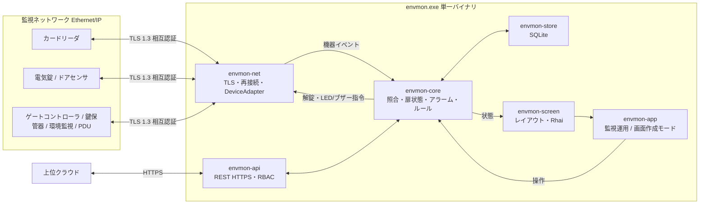
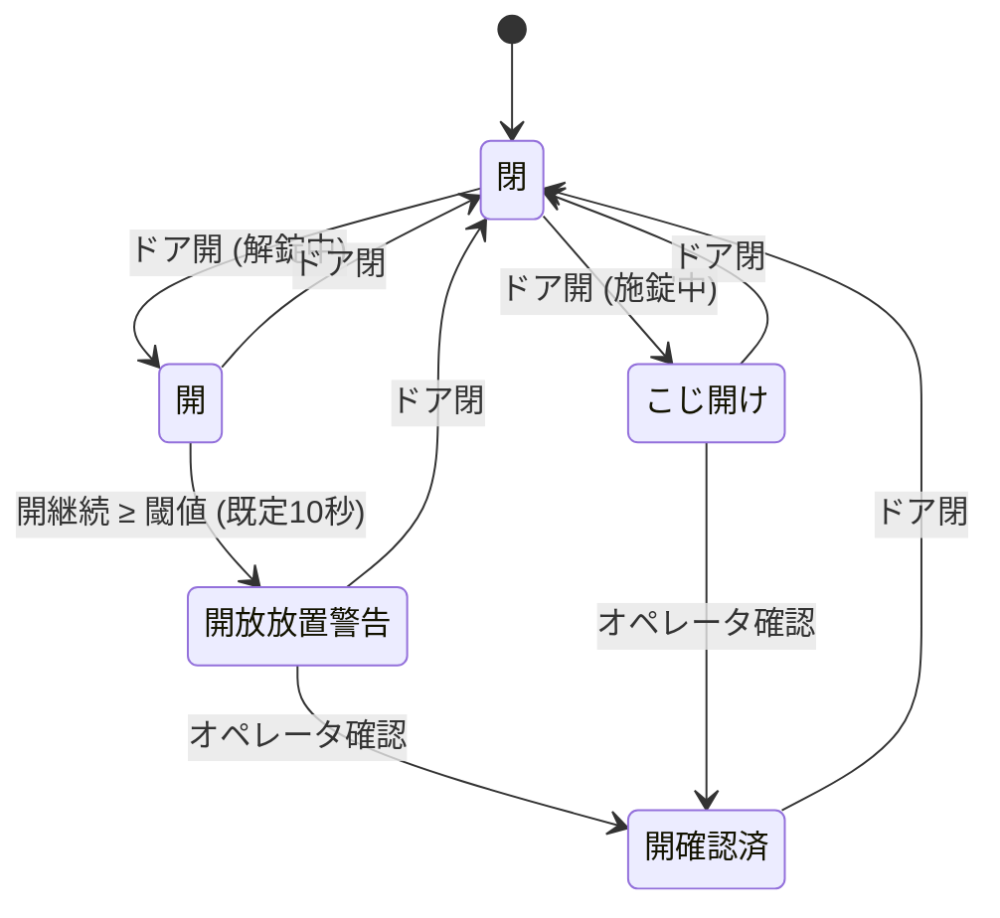

# アーキテクチャ v0.2

ステータス: **PO 確認待ち**。[spec.md](spec.md) と [requirements.md](requirements.md) の推奨案を前提にしている。

## 1. 全体構成



## 2. クレート

| クレート | 役割 | フェーズ |
|----------|------|----------|
| `envmon-core` | ドメインモデル (ユーザ・カード・扉・権限・スケジュール)、照合、扉状態機械、アラーム、ルールエンジン。時刻は注入してテストする | P1〜 |
| `envmon-proto` | 自前電文のエンコード / デコード | P1 |
| `envmon-net` | tokio + rustls の TLS 接続、自動再接続、`DeviceAdapter` トレイトと機器種別ごとの実装 | P1〜 |
| `envmon-store` | SQLite への履歴・マスタ保存、起動時のメモリ索引構築 | P1 |
| `envmon-screen` | レイアウト JSON の読み書き、Rhai 実行、オブジェクトの表示内容算出 | P1 |
| `envmon-sim` | 機器シミュレータ (TLS サーバ)。結合テストと手動デモに使う | P1〜 |
| `envmon-api` | REST API (HTTPS)、RBAC | P5 |
| `envmon-app` | eframe / egui の GUI (`envmon` バイナリ)、警告音 | P1〜 |

GUI 以外のクレートは Windows 固有 API を使わず、Linux CI でもテストできる。

## 3. 機器の抽象化 (HW-1)

```rust
trait DeviceAdapter: Send {
    async fn next_event(&mut self) -> Result<DeviceEvent, DeviceError>;
    async fn send(&mut self, cmd: DeviceCommand) -> Result<(), DeviceError>;
}

enum DeviceEvent {
    CardRead { reader: ReaderId, card: CardId },
    LockState { door: DoorId, state: LockState },   // 施錠 / 解錠 / 異常
    DoorSensor { door: DoorId, open: bool },
    // P2〜: Analog, DigitalIn, KeyTaken, KeyReturned, PduReading ...
}

enum DeviceCommand {
    Unlock { door: DoorId, duration: Duration },
    ReaderFeedback { reader: ReaderId, led: Led, buzzer: Buzzer },
    // P2〜: DigitalOut, OutletPower ...
}
```

シミュレータ用アダプタと実機用アダプタを同じトレイトで実装し、`envmon-core` はどちらにも依存しない。

## 4. 主要な流れ

### 4.1 照合と解錠 (AC-1)

1. `CardRead` を受け、カード ID → ユーザ → 扉権限 → スケジュール → 有効期間を照合する (メモリ上の索引で PF-1 の 10 ms 以内)
2. 許可なら `Unlock` と OK の `ReaderFeedback` を送る。拒否なら NG の `ReaderFeedback` を送る
3. 結果を履歴に保存する

### 4.2 扉状態とアラーム (AL-1, ST-1)



- 開放放置警告・こじ開けの間は警告音を鳴らし、ドアアイコンを赤点滅させ、アラーム一覧に表示する
- 機器と通信できない間は電気錠を「異常」として表示する

## 5. 監視画面 (UI-1〜4)

- 監視運用モードと画面作成モードを同一バイナリで切り替える
- 下絵は PNG / JPEG (`image`)、SVG (`resvg` でラスタ化)。ズーム・パンとフロア / エリアの階層切替を持つ
- レイアウト JSON: 階層、下絵、オブジェクト (種別・位置・通信 ID・表示スクリプト)
- 表示スクリプト (Rhai) がオブジェクトの状態から表示内容を返す。GUI はその結果を描くだけで、顧客ごとのコード変更はしない

```rhai
fn door(state) {
    if state.alarm { #{ icon: "door_open", color: "red", blink: true } }
    else if state.open { #{ icon: "door_open", color: "orange" } }
    else { #{ icon: "door_closed", color: "green" } }
}
```

- スクリプトには操作回数の上限を設け、ファイル・ネットワークへのアクセスを与えない。エラー時は既定の表示に戻し、アラーム一覧にスクリプトエラーを出す
- PF-2 (5,000 オブジェクト 30 fps) のため、スクリプトは状態が変わったオブジェクトだけ再評価し、画面外のオブジェクトは描かない

## 6. 通信 (NW-1)

- 機器との接続は TLS 1.3。アプリと機器の双方が自前 CA の証明書で相手を認証する
- 証明書がない・検証に失敗した接続は確立しない。平文は構成ファイルで明示的にデバッグ許可したときのみ
- 接続断は指数バックオフで再接続し、機器ごとに独立して扱う

## 7. テスト方針

| 層 | 方法 |
|----|------|
| 照合・扉状態・アラーム・ルール | `envmon-core` の単体テスト (時刻注入) |
| 電文 | `envmon-proto` の単体テスト (正常・不正電文) |
| 通信 | `envmon-sim` を相手にした TLS 結合テスト (切断・再接続・証明書不正・平文拒否) |
| 画面 | `envmon-screen` の単体テスト、`egui_kittest` による GUI 操作テスト |
| 性能 | 20 万ユーザ照合 10 ms 以内、5,000 オブジェクトの状態更新・描画 30 fps 以上 |
