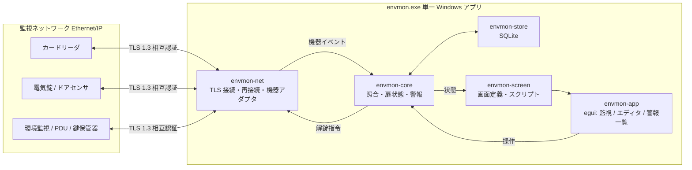
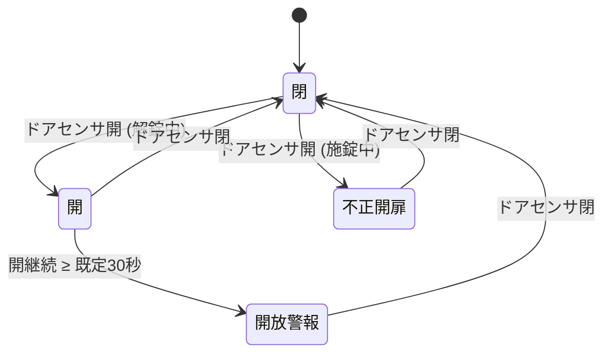

# アーキテクチャ (案) v0.1

ステータス: **PO 承認待ち**。[requirements.md](requirements.md) §8 の推奨案を前提にしている。

## 1. 全体構成



## 2. クレート

| クレート | 役割 | GUI 依存 |
|----------|------|----------|
| `envmon-core` | ドメインモデル (ユーザ・カード・扉・権限)、照合、扉状態機械、警報。時刻は注入するので待ち時間なしでテストできる | なし |
| `envmon-proto` | 自前電文のエンコード / デコード | なし |
| `envmon-net` | tokio + rustls による TLS クライアント、自動再接続、`DeviceAdapter` トレイト | なし |
| `envmon-store` | SQLite への履歴・マスタ保存 | なし |
| `envmon-screen` | 画面定義 (JSON) の読み書き、Rhai スクリプト実行、オブジェクトの表示内容 (アイコン・色・点滅・ラベル) の算出 | なし |
| `envmon-sim` | 機器シミュレータ (カードリーダ・電気錠・ドアセンサ)。TLS サーバとして動き、結合テストと手動デモに使う | なし |
| `envmon-app` | eframe / egui の GUI (`envmon` バイナリ)。監視モード、画面作成モード、警報一覧、警報音 | あり |

GUI 以外のクレートは Windows 固有 API を使わず、Linux CI でもテストできる。

## 3. 主要な流れ

### 3.1 カード照合と解錠

1. `envmon-net` がリーダ電文を受信し、`CardRead { reader, card, at }` を `envmon-core` に渡す
2. `envmon-core` がカード → ユーザ → 扉権限 → 有効期間を照合する
3. 許可なら `Unlock { door, duration }` を電気錠へ送り、解錠時間経過後に施錠する。拒否ならリーダへ拒否を返す
4. 結果を履歴に保存し、画面の状態を更新する

20 万ユーザでも照合がメモリ上の索引 (カード ID → ユーザ) 1 回で済むようにする。

### 3.2 扉状態と警報



- 開放警報・不正開扉中は警報音を鳴らし、ドアアイコンを赤点滅させる
- オペレータが「確認」すると警報音は止まり、赤点滅はドアが閉じるまで続く
- 機器と通信できない間は扉の状態を「通信断」として表示する

## 4. 監視画面とスクリプト

- 画面定義 (JSON): 下絵ファイル、オブジェクト一覧 (種別・位置・サイズ・紐付く機器の点)
- 表示スクリプト (Rhai): オブジェクトの状態から表示内容を返す関数。顧客ごとに差し替える
- GUI は画面定義とスクリプトの結果を描くだけで、顧客ごとのコード変更はしない

```rhai
// 例: 扉オブジェクトの表示
fn door(state) {
    if state.alarm { #{ icon: "door_open", color: "red", blink: true } }
    else if state.open { #{ icon: "door_open", color: "orange" } }
    else { #{ icon: "door_closed", color: "green" } }
}
```

スクリプトは操作回数の上限を設け、ファイル・ネットワークへのアクセスを与えない。エラー時は既定の表示に戻し、警報一覧にスクリプトエラーを出す。

画面作成モードでは、下絵の読込、オブジェクトの配置・移動・削除、機器の点との紐付けを GUI 上で行い、画面定義 JSON として保存する。

## 5. 通信

- 機器との接続はすべて TLS 1.3。アプリと機器の双方が自前 CA の証明書で相手を認証する
- 証明書がない・検証に失敗した接続は確立しない (フェイルクローズ)
- 接続断は指数バックオフで再接続し、機器ごとに独立して扱う
- 実機対応は `DeviceAdapter` の実装を追加して行う (§requirements 6)

## 6. テスト方針

| 層 | 方法 |
|----|------|
| 照合・扉状態・警報 | `envmon-core` の単体テスト (時刻注入) |
| 電文 | `envmon-proto` の単体テスト (正常・不正電文) |
| 通信 | `envmon-sim` を相手にした TLS 結合テスト (切断・再接続・証明書不正) |
| 画面 | `envmon-screen` の単体テスト、`egui_kittest` による GUI 操作テスト |
| 規模 | 20 万ユーザ照合と 5,000 オブジェクト描画の性能テスト |
